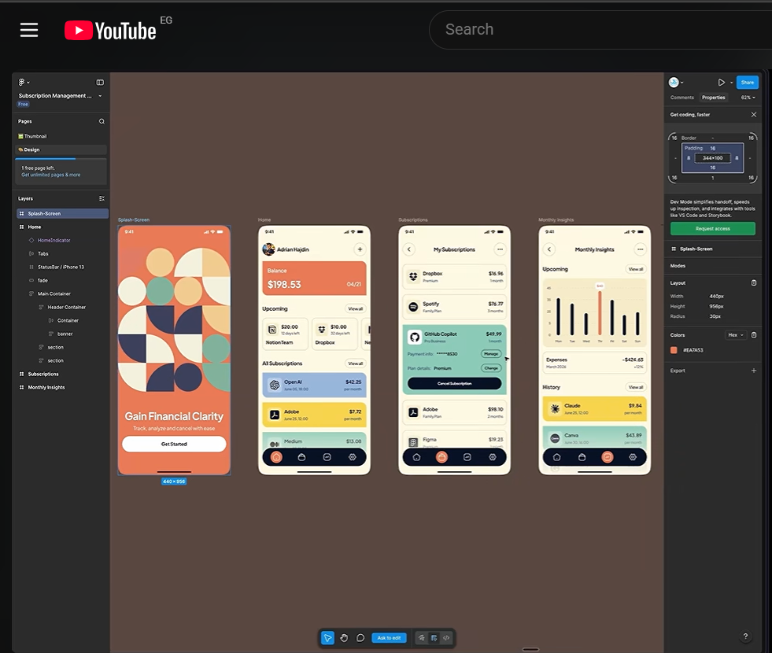

# Recurrly

<p align="center">
  
</p>

https://docs.expo.dev/build-reference/apk/

Recurrly is a mobile subscription tracker built with Expo and React Native. It brings subscription costs, upcoming renewals, and account access together in a friendly mobile interface.

> The image above is the project's design reference. Some screens shown in the design are still works in progress in the app.

## What the app does

- **Home:** Shows a balance summary, upcoming renewals, and subscription cards. Tap a card to expand its details.
- **Add a subscription:** Create a subscription with a name, price, billing frequency, and category. New entries are held in app state and are not saved to a backend or across app restarts yet.
- **Subscriptions:** Browse and search the sample subscription list by name, plan, or category.
- **Authentication:** Sign in and sign up with Clerk. The sign-in flow supports password and email-code authentication.
- **Analytics:** PostHog is wired for account and subscription interaction events.
- **Navigation:** Expo Router provides file-based routes and a custom bottom tab bar.

The Insights and Settings screens are currently placeholders. Subscription and balance data are sample data; this project does not yet include a subscription database or payment integrations.

## What I learned

- How to structure a mobile app with Expo Router layouts, route groups, and tabs.
- How to style React Native components with NativeWind utility classes and a shared theme.
- How to build reusable components, searchable lists, expandable cards, and a form modal using React Native primitives.
- How to validate form input and format currency and dates with JavaScript and Day.js.
- How to integrate Clerk authentication and keep its session token in secure storage.
- How to add product analytics with PostHog, including events and user identification.
- How platform-specific styling differs: Android uses `elevation` for shadows, while iOS uses shadow properties such as `shadowColor`, `shadowOpacity`, and `shadowOffset`.
- How to configure Expo app settings, environment variables, and EAS build profiles.

## Tools and libraries

| Tool or library | Why it is used |
| --- | --- |
| [Expo](https://expo.dev/) and [React Native](https://reactnative.dev/) | Build and run the cross-platform mobile app. |
| [Expo Router](https://docs.expo.dev/router/introduction/) | File-based routing, layouts, and app navigation. |
| [TypeScript](https://www.typescriptlang.org/) | Type-safe screens, subscription data, and reusable component props. |
| [NativeWind v5](https://www.nativewind.dev/v5/getting-started/installation) (release candidate) and Tailwind CSS | Style React Native views with utility classes and shared design tokens. |
| `react-native-css` | Provide the `styled` helper used to apply styles to safe-area views. |
| [Clerk Expo](https://clerk.com/docs/guides/development/custom-flows/authentication/email-password) and `expo-secure-store` | Sign-in and sign-up flows, with secure local session-token storage. |
| [PostHog React Native](https://posthog.com/docs/libraries/react-native) | Capture product events and associate analytics with signed-in users. |
| [Expo Vector Icons](https://icons.expo.fyi/Index) | Provide icons from Ionicons, Font Awesome 6, and Fontisto. |
| [Day.js](https://day.js.org/) | Calculate renewal dates and format dates. |
| `react-native-safe-area-context` | Keep screen content clear of device notches and system areas. |
| [EAS Build](https://docs.expo.dev/build/introduction/) | Configure development, preview, and production build profiles. |
| [Figma](https://www.figma.com/) | Create and review the design reference shown above. |

## Run the app locally

### Requirements

- Node.js and npm
- An iOS simulator, Android emulator, or compatible device
- A Clerk application and a PostHog project for authentication and analytics

### Setup

1. Install the dependencies:

   ```bash
   npm ci
   ```

2. Create a local environment file from the example:

   ```bash
   copy .env.example .env
   ```

   Add your Clerk publishable key and PostHog project token and host to `.env`. These values are required by the app; use your own project credentials and do not commit the `.env` file.

3. Start Expo:

   ```bash
   npx expo start
   ```

   Follow the terminal instructions to open the app in Expo Go, a development build, or a simulator.

You can also use `npm run android`, `npm run ios`, or `npm run web` to start the corresponding Expo target.

## Environment variables

| Variable | Purpose |
| --- | --- |
| `EXPO_PUBLIC_CLERK_PUBLISHABLE_KEY` | Connect the app to your Clerk instance. |
| `EXPO_PUBLIC_POSTHOG_PROJECT_TOKEN` | Enable PostHog event collection. |
| `EXPO_PUBLIC_POSTHOG_HOST` | Set the PostHog host for your project. |

The `EXPO_PUBLIC_` prefix means these values are bundled into the client app. Use only public client-side keys here; never put secret API keys or passwords in this file.

## Useful commands

```bash
npm run lint
npx tsc --noEmit
npx expo-doctor
```

## Project structure

```text
app/                 Screens, route groups, and navigation layouts
components/          Reusable subscription cards, forms, and icons
constants/           Sample data, images, and analytics setup
utils/               Date and currency formatting helpers
assets/              Fonts and app images
```

## References

- [Expo documentation](https://docs.expo.dev/)
- [Expo Router documentation](https://docs.expo.dev/router/introduction/)
- [NativeWind v5 installation](https://www.nativewind.dev/v5/getting-started/installation)
- [Expo Vector Icons](https://icons.expo.fyi/Index)
